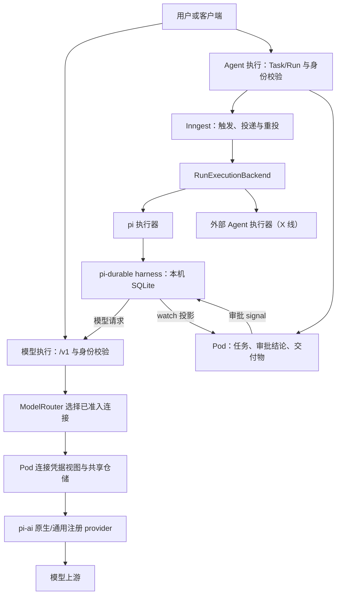

# Xpod 模型执行与持久执行规格（Pi 1.7）

状态：Draft，供讨论。日期：2026-11-24。

本规格覆盖两条**可独立交付**的线。各线有自己的完成标准（§16），一条线的成功不能推断另一条，一条线受阻也不阻塞另一条发布：

1. **M 模型执行**：Xpod 公开 `/v1` 接口由 `ModelRouter` 选择已准入连接，再交给 pi-ai 原生或通用注册 provider 执行。pi 已覆盖的 provider 协议、认证和模型发现走 pi，删除 Xpod 的重复实现；pi 无等价能力的窄操作只作为已注册的显式插件存在，不形成静默并行引擎。这不是“所有订阅和 API 都合法”的承诺，订阅准入见 §5.4。
2. **D 持久执行与本机会话**：Task/Run 的对外合同不变；pi 执行器的会话、回合提交和审批等待由 pi-durable 在执行设备本机持久化（§3.3、§6），替代自写的续跑协议和整轮重跑。Inngest 保留为触发与投递层。Pod 保存任务、审批结论和用户选定的交付物。

外部 Agent 执行器（AGY、Claude Code）是第三条线 **X**，见[外部 Agent 执行器规格](external-agent-executors.md)。它复用本规格的执行合同（§3.2）、两层持久分工（§3.3）和本机会话位置（§6），按执行器作为可选组件推进，不作为 M、D 的发布前提。

本文档交付规格和验收条件。

## 0 接入原则

遵循 pi 的设计，每个供应商或能力只能归入下面三层之一，不另开第四条自建路径：

1. **原生 API 直接转发**：供应商的原生 API 允许第三方访问时，经 Xpod `/v1` 由 pi-ai 发出请求（M 线）。包括 API Key、各家 Coding/Token Plan 的 Key，以及官方明确允许第三方使用的订阅接入。
2. **Agent 套在 pi 里**：需要 Agent 能力时使用 pi 执行器，持久化由 pi-durable 承担，Inngest 只负责触发与投递（D 线）。
3. **通过 ACP 接入外部 Agent**：原生 API 未覆盖的 Agent 能力，在厂商允许的范围内通过统一的 ACP 执行器接入（X 线，见外部 Agent 执行器规格）。首版 AGY 使用原生 ACP，Claude Code 使用经过审查的 ACP 适配器。

已按此原则决定：Claude Pro/Max 订阅**不进入模型执行**。依据是 Anthropic 的[认证规则](https://code.claude.com/docs/en/legal-and-compliance#authentication-and-credential-use)。按[计费说明](https://support.claude.com/en/articles/15036540-use-the-claude-agent-sdk-with-your-claude-plan)，用户以订阅登录运行 `claude -p` 或 Agent SDK 时，用量计入套餐限额。Claude ACP 按实际适配器的认证方式和使用范围单独验收。Anthropic 模型经 API Key 直接转发。目录中现有的 Anthropic `official-subscription` 在 P2 下线。

## 1 依据与适用边界

- [AGENTS.md](../AGENTS.md) 定义 schema、目录、业务行为和共享仓储的归属。
- [目录归属](catalog-ownership.md) 定义 provider/offering 内容由 AI Connections 能力模块维护，models 只拥有 schema。
- [AI Connections 产品规格](ai-connections-product-spec.md) 及其明确引用的 [桌面设计](superpowers/specs/2026-10-01-xpod-desktop-shell-and-applets-design.md) 定义产品边界。
- [认证权威边界](superpowers/specs/2026-08-30-xpod-auth-authority-boundaries.md) 定义 CSS Account、WebID 和供应商认证的独立职责。
- 初版接口依据为 Pi 1.6.0 的 [AI 文档](https://github.com/earendil-works/pi/blob/v1.6.0/packages/ai/README.md)、[包定义](https://github.com/earendil-works/pi/blob/v1.6.0/packages/ai/package.json)、[Agent SDK 文档](https://github.com/earendil-works/pi/blob/v1.6.0/packages/coding-agent/docs/sdk.md) 和 [pi-durable README](https://github.com/earendil-works/pi/blob/v1.6.0/packages/durable/README.md)。1.7.0 以锁定包的实际接口为准，Durable 差异及升级验收见 §12.1。

“模型统一列表”和“同一服务商多连接”属于模型执行侧要求，不改变登录、授权和 Pod 生命周期。实现时同步更新相关产品文档的对应条目，不保留两套目标。

[扩展抽象审计](extension-abstraction.md) 的历史建议若将 provider 目录内容归入 models，按 AGENTS.md 和目录归属文档解释，不据此迁移目录或修改共享 schema。

## 2 现状与目标

**迁移基线**（2026-11-24 核对）：

- 初版审查时，主线和 mini 开发工作区使用 `@mariozechner` 作用域的 pi `0.55.4`（manifest `^0.55.1`）。本次独立 SDK 升级以已合入 staging 的 `@earendil-works` Pi `1.6.0` 为基线。
- `PiAgentRuntimeDriver` 用旧 Agent SDK 跑单次 agent 循环，会话管理器为内存模式，每次运行从 Pod 读回历史再 `replaceMessages()`。Gateway 另有自己的供应商协议、认证、设备码、会话导入和模型发现实现（`src/api/ai-gateway` 与 `packages/ai-connections*` 合计约 2.1 万行）。“Agent 用了 pi”不能证明“上游供应商接入已统一用 pi”。
- Inngest 注册三个函数：每分钟 cron 的到期任务扫描、事件任务、Run 投递。Run 先在当前进程内执行，同时投一条事件；进程崩溃后 Inngest 重投，由 `ManagedRunWorker` 从 Pod 读回并整轮重跑。整个 Run 只包在一个 `step.run` 里。
- 审批暂停与续跑由 Xpod 自写：续跑声明与释放、检查点、CAS（`src/api/tasks` 与 `RunApproval`，约 2900 行）。RC 上反复出现的“审批续跑 HTTP 400”出自这一层。

**目标版本**为 `1.7.0`。清单固定直接依赖的 `@earendil-works/pi-ai`、`pi-coding-agent`、`pi-durable`、`pi-schema` 和 `chord`；锁文件同时校验由 SDK 引入的 `pi-agent-core` 解析到同一版本。Coding Agent 要求 Node `>=22.19.0`。仓库继续优先使用 Bun，并实际验证 Bun 和 Node 分发入口。

**M 线目标行为**：

1. 所有允许第三方模型访问且 pi 已覆盖的供应商协议和认证使用 pi 上游实现，覆盖后删除 Xpod 中对应重复路径；仅在 pi 无等价能力的窄操作上保留注册的显式适配器。
2. 两条 OpenCode Go 连接共用一个服务商入口，调度由 Xpod 自动完成。
3. 获准用于当前用途的可用模型统一显示和搜索，包含部署提供的 `linx`、`linx-lite`；不单列“内置模型”区域。
4. 现有用户连接、模型选择和客户端凭据保持兼容，迁移不要求重新录入 Key。
5. 第三方供应商通过注册和通用声明扩展，不要求修改通用 UI 或核心路由分支。

**D 线目标行为**：

6. pi 执行器在模型请求、工具执行、审批等待中崩溃后，从当前回合的检查点续上，不整轮重跑，不重复执行已完成的工具。
7. 审批结论从 Pod 送达执行器的等待点，不再由 Xpod 维护独立的续跑协议。
8. 新会话的正文、工具明细和检查点留在执行设备；Pod 只收到任务、审批结论和用户选定的交付物（§6）。

不在本次范围：重写 CSS/Inrupt、修改 models schema、替换整个 Gateway、重建原生 SDK、自动替用户购买套餐、替用户接受法律条款、完成未授权登录或扩大权限。

## 3 运行时职责与调用链

### 3.1 模型执行

`ModelRouter` 是模型请求的唯一调度权威：先执行连接准入和用途校验，选定连接后通过隔离的凭据视图调用 pi-ai provider。pi 负责上游协议编码、认证转换和响应解析；Xpod 负责公开 API 合同、能力校验、事件转换、错误脱敏、多账号调度和运行证据。

“统一走 pi”指模型执行不保留 Xpod 自有的供应商 HTTP/协议实现。pi 目录没有等价能力的 embedding、非工具对话或其他窄操作，保留为同一注册面下的明确插件；这些插件不能悄悄接成第二条完整推理链，也不能在 pi 路径失败时无声明地切换到旧实现。

### 3.2 Agent 执行合同

Task/Run 的**对外合同**保持不变：任务的创建、审批、取消接口，以及 Pod 中的任务、审批结论和交付物记录。**内部的执行与续跑**交给各执行器自己的持久运行时：pi 执行器用 pi-durable（§3.3），外部 Agent 用官方客户端的原生会话（§6、X 线规格）。审批结论从 Pod 送达执行器的等待点：pi 经 signal，ACP 经原权限请求的回复。

执行侧复用 `RunExecutionBackend.start(input)`。pi 执行器与外部 Agent 执行器实现同一运行时合同，调用方不按执行器身份写分支。下表描述适配器内部能力，不声称现有接口已导出这些同名方法；只有实际缺失的事件才扩展现有类型。

| 合同操作 | 语义 |
| --- | --- |
| `createSession` | 在绑定的用户、工作区、执行器和任务上下文中创建会话，返回执行器原生会话标识 |
| `resumeSession` | 在同一用户、执行设备、执行器和工作区上按原生会话 ID 恢复，历史归属见 §6 |
| `prompt` | 发送用户回合，返回有界流式事件；不把原始供应商 API 响应直接透传为公开模型响应 |
| `events` | 文本、推理、工具调用/结果、状态和用量事件映射到现有 Run 事件合同 |
| `requestPermission` | 进入现有用户审批并表现为 `waiting_input`；默认不自动批准、不绕过 |
| `cancel` | 取消当前回合并收敛执行资源，不重放已完成的工具副作用 |
| `complete` | 记录完成状态、结束原因和可核对证据；失败与取消分别可辨识 |
| `error` | 分类错误、保留可公开的诊断信息，诊断输出有界且脱敏 |

执行器发现是独立的运行时注册表，不通过 `/v1/models` 暴露，不把执行器描述成 provider/offering。

Agent 内部的 pi SDK 调用 Xpod Gateway；Gateway 内的 pi provider 调用选定上游。两者配置必须分开，禁止 Gateway 将自己的上游又解析回同一 Gateway，形成递归调用。

### 3.3 持久执行：两层分工

pi-durable 先提交到存储再展示，覆盖 pi 执行器的以下持久能力：

| Xpod 现有实现 | pi-durable 对应能力 |
| --- | --- |
| 崩溃后 Inngest 重投、`ManagedRunWorker` 从 Pod 读回并整轮重跑 | 每步检查点的 Task、`harness.resume()` 从当前回合续上、模型请求失败计入重试、崩溃循环的 `restartLimit` |
| 审批暂停/续跑（续跑声明与释放、检查点、CAS） | `beforeTool` 门 + `signal`（可带截止时间），休眠时不占进程 |
| 重复投递核对 | 提交 `requestId` 幂等，`harness.submission(id)` 重启后重新取得 |
| `RunStateCenter` 订阅 pi 进程内事件再投影 | `watch()` 提交流（窗口化、可增量重连），作为 Pod 任务状态投影的来源 |

但 pi-durable 没有 cron/事件触发和跨机器作业队列，且同一存储只允许一个写进程，因此**不替换 Inngest**。两层分工：

- **Inngest 是平台作业层**：cron 与事件触发（`InngestTaskScheduler` 的到期任务和事件任务）、把 Run 投递到执行位置、Cloud 多实例下的作业队列与崩溃重投，以及索引等非对话后台作业。外部 Agent 同样由它投递。
- **pi-durable 是对话内的持久层**：回合、工具调用、审批等待和崩溃续跑。它替换 Xpod 自写的续跑声明/释放、检查点和 CAS，以及整轮重跑。存储为执行设备本机 SQLite。
- **衔接**：Inngest 重投同一 Run 时以 `requestId` 交给 harness，已接收的提交不重复；harness 从检查点续上。审批结论经 signal 送达 harness，不经 Inngest 另建续跑事件。本迁移不扩大 Inngest 的职责，只划清“投递”与“执行”的边界。

**工具副作用的续跑**。`requestId` 只对回合提交去重。工具可能已在外部生效、结果却还没提交到本机存储。pi-durable 会根据工具的重放策略重跑或报告中断。每个工具在注册时声明属于哪一类：

| 类别 | 例子 | 崩溃后续跑 |
| --- | --- | --- |
| 只读 | 读文件、查询、搜索 | 直接重跑 |
| 幂等 | 带幂等键的 HTTP 写入、按内容写入的 Pod 资源 | 用工具调用 ID 派生的幂等键重跑，外部系统按键去重 |
| 可对账 | 能按标识查询结果的外部写入 | 先查询外部结果：已生效则补交结果，未生效再执行 |
| 不可确认 | 无幂等键、也无法查询结果的 shell 命令或外部写入 | 不自动重跑：该操作标为“待确认”，Run 进入 `waiting_input`，由用户确认已生效、重试或放弃 |

未声明类别的工具按“不可确认”处理。harness 宿主持久记录工具调用已开始的标识，恢复时先核对已提交的工具结果。结果缺失且不可确认时，先持久化 `waiting_input`，拦住该 Run 的下一次模型请求及工具重试，再等待用户决策。用户确认已生效时，按用户确认的结论继续原回合。明确重试时，记录一次新的工具尝试并按原权限策略执行。选择放弃时，结束该操作并记录结论。

**审批送达**。审批结论先写入 Pod，再以 signal 送达执行设备上的 harness；两步之间可能断开。执行设备上的 harness 宿主在启动、重连和定期对账时，读取 Pod 中绑定本设备执行尝试的已决审批，对仍在等待的任务补送 signal。返回 `delivered` 或 `duplicate` 都视为已送达，宿主随后在 Pod 写回送达确认；`closed` 表示任务已结束或已过期，写回对应状态，不再重试。审批只对其绑定的执行尝试送达，执行尝试已被替换时旧审批不送达。

**本机单写者**。同一台设备上可能同时启动多个 Xpod 进程（桌面、CLI、重启残留）。harness 宿主在打开运行时存储前取得该存储目录的操作系统文件锁（随进程退出自动释放）；取得锁的进程是唯一写者，负责 `resume()`、送达 signal 和投影。未取得锁的进程只以只读方式打开存储用于显示，或把请求转交持锁进程，不自行写入。持锁进程退出或崩溃后，其他进程取得锁并调用 `resume()` 接管，从检查点继续。

规划中的索引作业（向量补算、重建索引）属于 Inngest 平台作业层，不进入 pi-durable，须满足：

- **按批次分步**：每批一个 `step`，以已处理位置为检查点，崩溃后从上一批续上；不再像现有 Run 那样一个步骤包住整件事、失败后从头重跑。
- **按 Pod 限流与并发**：同一 Pod 的索引作业串行或有上限，不与用户交互请求抢同一上游额度；限流与冷却沿用 §7 的分类，套餐耗尽时暂停作业，不换账号绕过。
- **用途准入**：向量计算经 `ModelRouter` 以“索引”用途选择连接，只用 §5.4 允许该用途的连接（例如 OpenCode Go 不用于向量索引）；没有合格连接时作业保持待处理并显示原因，不静默改用其他连接。

约束：

- pi-durable 标注为 Experimental，版本间 API 可能变化：锁定与 pi-ai 相同的版本，以契约测试覆盖本节用到的接口，升级须重新通过。
- 执行设备上以文件锁保证单写者（见上）；Cloud 侧若运行 pi 执行器，须保证同一会话只由一个实例拥有，未证明前不在 Cloud 多实例上启用 pi-durable。

## 4 目录与供应商扩展

### 4.1 单一来源

产品 provider/offering 目录仍归 `@undefineds.co/ai-connections`。pi 的供应商能力通过注册入口接入该目录；已有事实从上游声明投影，不再手写第二套 endpoint、认证方式和模型能力清单。

Xpod 自有的产品展示、部署策略、套餐语义和额度能力由相应模块补充。补充项只引用上游能力，不复制一份完整 pi provider 定义。

目录标识与 pi runtime provider 标识只在一个边界映射；UI 不推导别名，不通过 `if (provider === ...)` 决定功能。程序支持哪些能力属于随版本发布的声明，不写入用户 Pod 作为可执行配置。执行器描述同样属于程序侧声明，不进入 provider/offering 模型目录。

### 4.2 扩展路径

| 新增场景 | 实现要求 | 验收 |
| --- | --- | --- |
| pi 原生供应商 | 注册官方 factory 并补充必要产品声明 | 无重复认证/请求解析实现，真实请求成功 |
| OpenAI 等已支持兼容协议 | 使用通用 provider，声明 endpoint、协议和能力 | 合成新供应商无需改通用 UI/Router |
| 独有推理协议 | 实现统一运行接口的插件并注册 | 同一取消、错误、流式和用量合同 |
| pi 已支持的 OAuth | 适配其交互和凭据接口 | 登录、刷新、重新登录及撤销状态正确 |
| 未覆盖的 OAuth/会话导入 | 统一认证或导入接口的窄插件 | 不另建全局认证系统或隐式读取本机文件 |
| 官方额度/余额 | 注册额度插件 | 来源、时间、单位、未知状态完整 |
| pi 未覆盖的模型类型 | 注册操作能力插件 | 不丢弃原有 embedding 等能力 |

注册插件是受审查的程序代码，不接受 Pod 中的脚本、动态 import 地址或任意命令作为插件。通用声明能表达的功能不得增加专有分支。外部 Agent 不是模型插件，不进入模型目录。

## 5 凭据与多账号

### 5.1 三类认证相互独立

- CSS Account/Solid 客户端凭据遵循现有权威合同；当前 Xpod 客户端 Key 是该凭据的产品包装，不另建一套发行和验证存储。
- WebID 会话及其 Pod 授权保持 Inrupt/CSS 的既有边界。
- 获准使用的 OpenCode、Anthropic API 等上游凭据交给 pi 使用，仍归对应用户连接，不充当 Xpod 客户端凭据。SDK 能解析某类凭据不代表允许收集、存储或转发该类凭据，接入前适用 §5.4。外部 Agent 的登录态归官方客户端，不进入 pi 模型凭据或 Pod 凭据字段（X 线规格）。
- 账号页显示当前 Account 权威实际返回的凭据元数据，读取失败不能显示为“没有凭据”；不把其他 Account、WebID 或 CO/CN 权威下的凭据混入列表。该问题的修复和验收单独记录。

### 5.2 每连接的 pi 视图

pi 标准 `CredentialStore` 按 provider 保存一条凭据。Xpod 必须为每个选中连接提供隔离的存储视图，避免同一供应商的两个账号相互覆盖。适配器身份至少绑定已有的用户/Pod 权威、连接资源标识及运行版本；SDK 内部 provider id 不能代替用户连接 id，也不能成为全局“当前账号”变量。

以下是设计约束，具体 TypeScript 签名以锁定 SDK 的导出为准：

| 操作 | 语义 |
| --- | --- |
| `read` | 仅读取绑定连接的当前凭据；权限或读取错误显式失败 |
| `list` | 仅返回该视图允许的非敏感元数据，不解析密钥或执行命令 |
| `modify` | 串行读取、更新并持久化同一连接，校验版本和撤销状态 |
| `delete` | 只响应已有明确撤销操作，不因缓存清空或迁移自动删除 |

不复制到全局 `~/.pi/agent/auth.json`；不从环境变量或旧账号静默补取用户凭据；不把 Key 字符串解释为 shell 命令。部署自有服务凭据仍遵循部署配置合同，不下发给客户端或写入用户 Pod。

### 5.3 OAuth 刷新与失效

对于 §5.4 允许的接入方式，pi 负责上游的登录、刷新和请求认证转换；Xpod 负责把交互接入现有授权流程，并在同一连接内安全提交刷新结果。

1. 同一凭据的刷新须在发出上游刷新请求之前串行化。多进程部署需要覆盖读取、刷新和提交的跨进程锁或等价协调，并用版本比较保护提交。仅在刷新后做 CAS 仍可能让两个进程同时使用同一枚轮换 token。
2. 刷新后的完整受支持 payload、轮换 token 和有效期一起保存，不因字段映射丢失刷新必需数据。
3. 持久化失败不得宣称已完成持久刷新，也不能覆盖其他请求已提交的新版本。
4. 刷新失败保留可供重新登录的记录并标明需要处理；不回退到其他来源的同名凭据。
5. 连接被撤销、身份切换或凭据版本更新后，旧异步结果不能提交；下一次请求重新检查有效状态。
6. Pod 仓储优先使用 drizzle-solid；缺少并发原语时先记录能力缺口并解决，不在业务层绕过权限或伪造 CAS。

本机登录态导入仅在宿主明确具备能力且用户发起时进行。服务启动不自动扫描浏览器、其他 CLI 或全局 pi 的凭据目录。

### 5.4 订阅接入范围与产品准入

技术兼容、官方授权的使用范围、当前账号权限和真实请求通过是四个独立条件。pi 实现了某种 OAuth 或能够发送请求，不会扩大订阅套餐的授权范围。下表是 2026-11-24 核对的准入基线，启用新接入方式前必须复核对应官方来源。

| 接入方式 | 当前官方边界 | Xpod 设计决定 |
| --- | --- | --- |
| OpenCode Go Key | [官方说明](https://opencode.ai/docs/console/go/)支持 API 和其他 coding agent，要求典型 coding 流量、真实客户端标识及稳定会话信息 | 允许符合约定的编码工作流；不用于任意批处理、向量索引或通用转售。保留会话信息，用自己的客户端标识，不伪装 OpenCode/Pi |
| Claude 个人订阅 OAuth | [官方认证规则](https://code.claude.com/docs/en/legal-and-compliance#authentication-and-credential-use)限制第三方代用订阅凭据；[计费说明](https://support.claude.com/en/articles/15036540-use-the-claude-agent-sdk-with-your-claude-plan)说明订阅登录的 `claude -p` 或 Agent SDK 计入套餐限额 | 走第 3 层的 Claude ACP 执行器，按实际认证模式验收。P2 下线模型目录中的 Anthropic `official-subscription`；模型推理使用官方 API Key 或支持的云平台 |
| ChatGPT 计划用量 | [官方接入说明](https://developers.openai.com/siwc/quickstart)区分身份登录与套餐推理权限；[使用条款](https://developers.openai.com/cookbook/articles/sign-in-with-chatgpt#usage-policy-and-terms)规定本地开源接入范围，付费或远程托管须另行申请 | 走第 1 层，作为 OpenAI 的一个订阅套餐，经统一 OAuth 接口和 pi-ai 执行。用 Xpod 自身的应用身份完成授权，获得套餐调用权限并通过真实推理后，在已核实的部署与访问范围内启用 |
| 其他 API Key 或 Coding Plan | 以各 provider/offering 的正式 API、套餐用途和部署约定为准 | API Key 也不默认拥有任意用途、地区、多人共享或转售权限；缺少依据时不启用订阅转接 |

准入声明属于程序侧能力目录，至少说明接入方式、允许的工作负载/部署范围、令牌持有边界、会话要求和额度耗尽处理。UI、Router 和索引作业消费同一声明；不能由用户 Pod 中一个布尔开关跳过，也不能仅凭请求自报的 User-Agent 判定用途合格。

各供应商套餐共用供应商页面、连接管理、模型列表、路由和状态展示。供应商自己的授权协议、已授予权限和可用范围由套餐声明与已注册的认证适配器表达。远程托管或经隧道访问时，按同一准入规则核实实际使用场景。

若官方 SDK 要求在本机特定会话中持有 token，不能直接套用通用 Pod CredentialStore。先明确 SDK 会话的权威和持久化合同，必要时使用官方会话适配器，仅向通用层投影合法元数据；未明确前不收集 token，不另建第二份密钥存储。

OpenCode [条款](https://opencode.ai/legal/terms-of-service)禁止用多账号绕过使用限制。多连接的存在不证明它们可以合并为更大的额度池；429 接替必须检查限制类型和接入合同。已有两条连接的账号/计费归属与可用范围作为具体实施证据，不能仅凭两次请求成功推断允许合并。

官方不允许的订阅转接以改用正式 API、获准的合作接入或官方客户端执行解决。修改请求头、复用他人 client id、导出登录态或改用 pi 均不是授权替代方案。

### 5.5 现有目录的归层

按 §0 对 `provider-catalog.ts`（staging `e2342b91e`）中的每个套餐归层，P2 按此表实施。第 2 层（pi 执行器）不按厂商划分：任何第 1 层模型都可以作为 pi 执行器的模型。“用途核对”指启用前按 §5.4 复核该套餐对工作负载（编码代理、索引等批处理）和部署范围的限制，未核对前不用于索引作业。

| 厂商 | 套餐（offering） | 接入方式 | 层 | pi-ai 对应 | 处理 |
| --- | --- | --- | --- | --- | --- |
| OpenAI | `official-subscription` | OAuth（Sign in with ChatGPT） | 1 | OpenAI | 使用 OpenAI 的统一供应商入口，按 §5.4 验证授权、用途及部署范围 |
| OpenAI | `api-platform` | API Key | 1 | OpenAI | 直接转发 |
| Anthropic | `official-subscription` | OAuth | 3 | — | **P2 下线**；订阅模式在 Claude ACP 执行器中验收 |
| Anthropic | `api-platform` | API Key | 1 | Anthropic | 直接转发 |
| Kimi | `subscription-key`（Kimi Coding Token Plan） | API Key | 1 | Kimi For Coding | 用途核对 |
| Kimi | `api-platform`（Moonshot） | API Key | 1 | Moonshot AI（国内版） | 直接转发 |
| 百炼 | `pay-as-you-go` | API Key | 1 | 通用 OpenAI 兼容 | 直接转发 |
| 百炼 | `token-plan`、`token-plan-team` | API Key | 1 | Qwen Token Plan（个人/团队，国内版） | 用途核对 |
| 百炼 | `coding-plan` | API Key | 1 | 通用 OpenAI 兼容 | 用途核对 |
| DeepSeek | `api-platform` | API Key | 1 | DeepSeek | 直接转发 |
| 智谱 | `api-platform` | API Key | 1 | 通用 OpenAI 兼容 | 直接转发 |
| 智谱 | `coding-plan`（GLM Coding） | API Key | 1 | ZAI Coding Plan（国内版） | 用途核对 |
| Ollama | `local` | 本机 | 1 | 通用 OpenAI 兼容 | 直接转发 |
| Custom | `openai-compatible`、`anthropic-compatible` | API Key | 1 | 通用 provider | 直接转发，按声明的 endpoint 与协议 |
| OpenCode | Go（分支 `cbeed65e7`，尚未进 staging） | API Key | 1 | OpenCode Go | 按 §5.4：编码工作流，不用于索引 |
| Google | Antigravity | 原生 ACP | 3 | — | AGY 执行器（X 线） |
| Anthropic | Claude Code | ACP 适配器 | 3 | — | Claude Code 执行器（X 线） |

“pi-ai 对应”一列依据 pi-ai 1.6.0 README 的 provider 清单，P2 以锁定版本的实际导出为准；清单中没有对应 provider 的，走通用 OpenAI/Anthropic 兼容 provider，不另写协议实现。

## 6 本机会话、Pod 任务记录和跨设备继续

新建 Agent 会话默认保存在执行任务的设备。比如在手机上向 mini 派任务，完整历史由 mini 保存；手机可查看 Pod 中的任务状态和已保存成果。普通模型 API 调用和已有非 Agent 聊天按各自的数据合同处理。

| 内容 | 保存位置与读取方式 |
| --- | --- |
| 对话正文、工具参数和结果、上下文压缩、会话检查点 | pi 执行器由 pi-durable 存在 Xpod 本机持久数据目录的 SQLite 中，按用户隔离。AGY 和 Claude Code 各自写自己的原生会话存储；Xpod 只通过协商后的 ACP 接口获取历史，并在本机保存会话绑定 |
| 当前回合的持久提交记录与会话绑定 | 执行设备保存 `run`、会话 ID、执行器、本机用户、工作区、提交和完成状态。pi 执行器以 pi-durable 的提交与 `requestId` 表达；绑定指向原生会话，完整 transcript 只保留一份权威记录 |
| 跨设备查看的任务详情 | Pod 经现有仓储保存 Task/Run 标识、用户提交的任务标题、执行设备和执行器引用、终态、时间以及审批结论。审批只保存确认动作所需的信息；正文和工具输出默认留在执行设备。原生会话 ID、本机绝对路径和凭据留在本机绑定中 |
| 工作文件和交付物 | 工作文件跟随指定工作区。用户选择保存到 Pod 的文档、结果或交接摘要通过已有 Pod 写入功能保存，按继承的权限共享；保存失败可重试写入同一交付物 |

同设备继续时，打开已绑定的精确会话，只提交新一轮输入。历史回放用于显示，历史工具事件不触发执行或审批。执行器缺少恢复能力时，将该会话标为单次执行。客户端清理会话后，Xpod 显示详细历史已不可用，任务和已保存交付物仍可从 Pod 查看。供应商对推理请求的处理和保留仍适用其服务条款。

跨设备优先把后续请求交回持有会话的原设备。设备离线时保留任务详情并显示等待执行设备。用户可以选择在另一台设备或另一个执行器新开会话，并带上选定的交接摘要和交付物；摘要只包含已完成工作、待处理事项和用户选择的上下文，须经用户选定后才随新任务送出。

同一个会话同时只运行一个回合。状态同步、取消和审批都绑定原执行尝试，防止重新提交已完成的操作。

### 6.1 跨设备派发与接收

以手机向 mini 派任务为例。发起端是手机，执行设备是 mini。正文在 mini 持久接收前留在手机待发队列，经已有设备访问路径传输。Pod 和传输通道均不持久保存这份正文。

1. **发起与送达**。手机生成并持久保存 `requestId`、目标设备和正文。mini 离线时在手机显示“待送达”，可达时用同一个 `requestId` 发送。若 Pod 已有“待送达”记录，mini 沿用该 Run。Pod 暂时无记录时，mini 仍可接收，随后补建同一 Run。
2. **接收与回执**。mini 按用户、Pod 和 `requestId` 核对提交，在正文与 Run 绑定持久保存后回执“已接收”。手机收到回执才删除待发正文。回执丢失时，手机可查询或用同一 ID 重送，mini 返回原回执。Run 状态分别显示本机接收与 Pod 同步进度。
3. **定时与事件任务**。Inngest 以触发实例对应的稳定 `requestId` 投递。mini 从 Pod 的任务定义读取输入，按同一接收合同持久保存；重投沿用原提交。定时任务的旧调度器和设备在派发前按 §6.3 取得该回合的共享 Run ID。

### 6.2 Pod 任务投影与同步游标

Pod 位置决定任务状态怎么同步。mini 是执行状态的权威，使用同一个 Run 标识与 Pod 对账：

| Pod 位置 | 投影与恢复 |
| --- | --- |
| Pod 与执行器都在 mini | 接收和执行状态落在 mini，通常经本机 Pod 仓储立即投影。若进程在本机提交后、Pod 写入前退出，或本机 Pod 服务暂时不可用，重启或服务恢复后按原 Run 记录补写。 |
| Pod 在 Cloud，执行器在 mini | mini 作为 Pod 客户端，把待同步的 Run 状态按本机递增序号持久保存。推送游标按用户、Pod 和执行设备保存在 mini 的 SQLite，表示 Cloud 已确认的连续本机序号。mini 启动或重连后从游标继续同步，Cloud 确认写入或 mini 读回确认后才推进游标。 |

游标记录的是同步进度，和 `requestId` 的回合去重各自独立。Cloud 写入成功后若回执丢失，mini 用同一 Run 标识和状态版本重送或读回确认。晚到的“待送达”或“已接收”更新不得覆盖更新的运行状态。若本机执行状态已提交、同步条目尚未保存，启动对账从本机 Run 补齐待同步记录。Cloud 离线期间，已接收且所需输入和权限均已在本机就绪的任务可以继续；需要远端审批时按 §3.3 等待决策。其他设备在同步完成前看到最近一次已同步的状态。

审批从 Pod 送达 mini 时按执行尝试与审批 ID 对账。Pod 仓储提供可靠的增量读取游标时，mini 在本机保存独立的拉取游标，待这一批决策已处理或写入本机待处理记录后再推进。其余情况按 §3.3 查找未确认审批。所有 Pod 投影通过现有仓储和共享资源标识完成。

迁移按会话生效。已有 Pod 会话可继续通过原路径读取和恢复；用户从旧会话开启本地续作时，只导入所选历史一次，保留原有 Pod 记录及关联。新建本地会话走本地恢复路径，Inngest 只传运行标识及必要调度元数据，待提交的正文落在执行设备。实施阶段必须同时检查 ChatKit 和 Inngest 的初始执行、审批续跑和写入路径，防止出现只改读取、仍把正文写入 Pod 的情况。

### 6.3 定时任务切换竞态修复

已知旧调度器和本地设备曾为同一到期回合产生不同 Run ID，且旧调度器保存过时快照时覆盖了设备绑定。按以下顺序实施与验收。

| 阶段 | 实施 | 验收条件 |
| --- | --- | --- |
| 1. 共享原子占用 | 以共享任务标识和计划到期时刻标识同一回合。旧调度器与设备在创建或派发 Run 前，都调用同一共享仓储的原子占用操作。首次占用一次性写入该回合与 Run ID 的关联。后续调用读回同一个 Run ID，并按已有占用结果决定是否派发。 | 控制两个入口同时竞争同一回合，分别让旧调度器和设备先到。每次只创建一条占用记录，双方读回相同的 Run ID。 |
| 2. 保护绑定和调度状态 | 设备绑定和调度推进按各自拥有的字段做条件更新。调度推进校验所读版本和预期回合；失败后重读当前记录，仅在该回合仍可推进时提交相应字段。旧调度器的保存路径不覆盖设备绑定。 | 让旧调度器先读，设备随后写入绑定，再放行旧调度器保存。读回确认绑定保留，调度更新符合当前回合和状态，过时写入不覆盖较新的状态。 |
| 3. 验证单回合唯一性 | 在实际调度入口组合前两阶段的交错。检查共享占用、持久化 Run 和派发记录，然后触发下一个到期回合。 | 同一到期回合最终只有一个 Run ID 和一个逻辑执行，调度状态只推进一次且设备绑定保留。下一到期回合产生自己的 Run ID。 |

## 7 模型路由与可靠性

Xpod 保持多连接选择和请求级故障转移的唯一权威，并先执行 §5.4 的用途、部署与额度准入。pi 和底层 SDK 的重试关闭或纳入同一尝试预算，不在两个层级分别无限重试；pi-durable 的模型请求重试同样纳入该预算。

- 同优先级、同能力范围的可用连接轮询；已有合法会话亲和按原合同保留。
- 暂停、撤销、冷却或不支持目标模型的连接不进入候选集；不为均衡擅自换成其他模型或其他用户的连接。
- 429 的 `Retry-After` 支持秒数和 HTTP 日期；响应体提示只按已注册协议中验证的字段解析。无效提示使用有界退避，不解析任意错误文案作为时间。
- 冷却按上游声明的限制范围记录；只在合同允许的候选中保留其他可用连接，不把单个模型限流扩大成整个平台故障。
- 临时并发/速率限制与订阅额度耗尽、组织级上限、权限拒绝分别分类。套餐耗尽不通过轮换账号绕过；可等待重置、使用已明确授权的官方额外用量或独立付费 API。新增计费不静默启用；无法判断限制类型时不当作可无限换账号的暂时故障。
- 首个不可重放的响应事件前，仅对明确可安全重试的失败换连接。已向客户端发出内容、推理或工具增量后，禁止透明重放，返回可辨识的中断结果。
- 超时和断连不一概当成“上游未执行”。工具副作用、未知提交结果和不可证明安全的重试停止并交给 §3.3 的恢复合同。
- 保留当前首响应等待与流式空闲超时语义；有效进展续期，不施加简单的固定总时长截断。空注释/保活不能无限掩盖没有业务进展的连接。
- 取消信号传递到调度、凭据访问、OAuth 刷新和上游流；结束时释放监听和资源，不启动新的替补请求。

执行器的故障转移不复用模型连接轮询：执行器由用户显式选择，失败不自动切到另一执行器，也不把配额耗尽转成另一账号。实现前固定当前模型超时、重试和亲和的基线测试，迁移不能无说明地改变这些行为或新增用户配置项。

## 8 对外协议与网络边界

Xpod 继续提供既有模型、Chat Completions、Responses、Messages 等端点。pi 是模型执行的内部实现，不要求调用方改 SDK、模型标识或凭据格式。Agent 执行通过现有 Task/Run 合同呈现，不新增“把 Agent 当模型”的公开端点。

转换必须覆盖流式与非流式、工具标识及增量、推理内容、终止原因、用量、图像输入、结构化输出，以及现有公开扩展字段。不能识别的能力在发起请求前明确拒绝，不静默丢字段后返回成功。

必须保留错误分类、真实上游状态和可信重试信息。若 pi 的标准错误事件未暴露必要信息，通过其支持的扩展点或注册适配器补足；不把所有错误压成 502，不为获取错误信息重复发送请求。

pi 的对话目录不是 Xpod 所有模型类型的全集。embedding、非工具对话或其他现有操作在 pi 无等价能力时，保留于同一注册面下的明确插件，不形成第二条未声明的回退引擎。

替换 HTTP 实现必须同时证明：

- Cloud 的端点白名单、私网访问限制、DNS/重定向策略和跨域凭据保护继续生效；只校验初始 URL 不足以证明安全。
- Local 允许的自建服务与代理配置仍按已有部署策略使用；从 Pod 提交的参数不能扩大 Cloud 权限。
- 不继承宿主环境中不属于当前用户的代理、Key、任意 header 或命令执行能力。
- 日志和错误移除 Key、Authorization、Cookie、OAuth code/state 和 token；上游原始正文不直接作为用户可见错误。

网络策略若无法通过 pi 的扩展点落实，视为该调用路径的切换阻塞项，不能先绕过再补。

## 9 服务商与模型界面

### 9.1 单一服务商下管理连接

OpenCode Go 展示一个服务商入口，里面管理两条或更多连接。A/B 可以继续作为用户编辑的连接名称，不是两个服务商身份；客户端和 subagent 不选择 A/B。

已知服务商按权威声明归组。自定义连接仅在 offering、协议、规范化端点及相关运行策略兼容时展示为同组，不仅凭相似标签、Key 前缀或模型名称归组；含不同认证信息或不兼容策略的端点不合并。

展示合组不合并凭据记录、不改变资源 id、不创建或删除 Key。对模型的组选取保存每条成员连接对应的既有资源引用；一条成员同步失败不能被后一条成功覆盖。

### 9.2 统一模型列表

所有来源使用同一列表、搜索和类型筛选。`linx`、`linx-lite` 与个人连接模型一起显示，不要求用户理解“内置”分类。模型来源可作次级信息；编辑、删除、选择和测试动作由能力声明决定。

模型发现、用户允许、实际可调用和用途已分配是四个不同事实。列表不能通过增加一行就宣称模型可调用，也不把发现的所有模型自动加入允许列表或替换默认用途。

规范路由标识由服务端/共享契约提供，UI 原样使用。去重不能仅比较裸模型名；不同服务商的同名模型保持独立。同一逻辑模型的连接副本可聚合展示，保存时仍保留成员资源关系，能力差异不能被并集虚构为所有连接都支持。

部署模型来自部署权威，用户连接及选择来自 Pod，以统一目录投影呈现。各来源的加载、失败、未知和空状态保持独立；个人 Pod 失败不能抹掉已知平台模型，也不能导致选择被空数组覆盖。

### 9.3 本机 Pod 与云端平台模型

CN 账号加本机 `gbb-mini` Pod 不自动等于本机拥有云端部署凭据。平台模型必须通过受信任的托管服务发现和实际可执行路由接入；本机不复制 `DEFAULT_API_KEY`，不要求用户额外填写部署密钥。

实施阶段明确已有的托管服务地址、身份呈现与调用授权合同，并分别验证目录和 Chat。仅声明 Cloud 模型不能证明本机能够执行；桥接能力未落实时显示不可用/待连接状态，不伪造可选模型。

## 10 额度与可观测性

pi 返回的 token 用量和费用估算不等于供应商剩余额度、订阅到期日或账单余额。这些事实继续通过已注册的官方额度插件取得。

额度快照包含对象、来源、单位、周期、采集时间及上游提供的重置时间；未支持、读取失败、过期和未知不显示为零。没有官方数据时只提供相应状态和已声明的控制台入口。

每次尝试记录脱敏连接引用、模型路由、实现版本、耗时、重试原因和冷却结果。持久执行另记录会话/任务作用域、检查点续跑次数、重投核对结果和 signal 送达结果。不记录 Key、登录 token 或用户文件内容；观测本身不生成额外推理请求。

## 11 依赖与分发

根包、实际发布的 API 包、锁文件和运行产物解析到同版本 SDK。以实施分支的包布局为准更新 `PiAgentRuntimeDriver`、ESM 打包和分发依赖声明。

运行产物必须能报告实际加载的 SDK 版本，不能只检查 manifest。许可文件、动态导入、所需资源和目标平台测试随分发更新，不把交互式 CLI 或无关构建工具混入服务产物。复用已验收的原生组件；本迁移不触发原生 SDK 重建。

Node 版本以仓库当前滚动维护的单一 LTS 为准（见 `docs/RELEASE.md`），需同时满足锁定 SDK 的最低要求。Bun、支持的 Node 分发路径及真实桌面使用同一版本的接口合同。

主程序保持轻量。pi-durable 运行时、注册的供应商插件和外部 Agent 执行器适配均作为可选组件按需下载，与[模块发布与安装合同](module-publication-v2.md)一致。以后可并入插件中心，服务主产物和桌面主包均通过模块机制加载。

## 12 实施阶段与交付物

M、D 两条线可以并行推进，各自通过检查后各自发布。顺序上先做 P1 与 D1：P1 是其他阶段的依赖；D1 替换的续跑实现是当前任务审批不稳定的来源。

| 线 | 阶段 | 主要文件范围 | 交付和退出条件 |
| --- | --- | --- | --- |
| M | P1 SDK 升级 | 根/package manifests、bun.lock、`PiAgentRuntimeDriver`、runtime ESM staging 及相关测试 | 1.7.0 在实际 Agent 和分发产物中加载，验证工具调用、取消、会话，以及 1.6 持久会话的升级恢复；Gateway 尚不切换 |
| M | P2 凭据适配 | credentials、connect、相关仓储接口和测试 | 隔离的 CredentialStore、OAuth 交互、并发刷新、撤销和持久化通过；不改现有凭据 id |
| M | P3 推理与扩展 | providers、model discovery、Gateway 协议桥接与重试边界 | OpenCode Go 及覆盖矩阵中的协议可执行；网络策略、错误元数据、流式语义通过；删除已覆盖路径 |
| M | P4 产品投影 | ai-connections 目录/模型视图、UI host adapter 和相关文档 | 单服务商多连接、统一模型列表、平台模型真实路由、选择回读通过；不创建额外 Key |
| M | P5 真实验收与清理 | 集成/桌面测试、迁移证据和依赖清理 | 完整矩阵通过，删除临时迁移入口及废弃实现，具备部署与回退说明 |
| D | D1 持久执行 | pi-durable 装配、审批 signal 桥接、Pod 投影、Inngest 投递到 harness 的衔接 | V32–V34 通过；删除被替代的续跑/检查点实现和整轮重跑路径，Inngest 只负责触发与投递 |
| D | D2 本机会话 | 本机会话、§6.1 跨设备接收、§6.2 本机 Pod 投影与 Cloud Pod 游标同步、旧 Pod 会话兼容 | V28–V31 通过，首批本机会话上线前完成 |
| D | D3 索引作业 | 索引作业的 Inngest 函数、分批检查点、Pod 限流、用途准入 | 向量补算和重建索引按 §3.3 分批续跑、限流和准入通过（V35） |

阶段可以拆成可独立审查的 PR，前置合同未通过不得切换依赖它的流量。每阶段记录替换了哪些旧实现、保留的每个插件缺口及其理由；“以后再删”的无期限双实现不算完成。

### 12.1 P1 升级差异

1.7 的 Durable 工具暂停结果使用 `kind: 'sleep'`，`checkpoint` 与 `signals` 位于同层。信号等待结果按 `kind: 'value'` 和 `kind: 'expired'` 处理。验收须覆盖旧 SQLite 会话在 1.7 重开、审批和工具等待恢复，以及以同一持久回合继续。分发验证须在 Bun 和 Node 中使用真实归档走首次安装、执行及重开路径。

以下记录 0.55.4 → 1.6.0 的历史迁移差异。

2026-11-24 对照 `@earendil-works/pi-coding-agent@1.6.0` 的 SDK 文档与 `dist/index.d.ts` 导出，逐项核对 `PiAgentRuntimeDriver` 与 `PiAgentRuntimeWorker` 的用法。尚未编译验证，以实际升级为准。

| 当前用法（0.55.4） | 1.6.0 情况 | 处理 |
| --- | --- | --- |
| `createAgentSession`、`SessionManager.inMemory/create`、`SettingsManager.inMemory`、`DefaultResourceLoader` | 仍导出 | 平移；按新签名核对参数 |
| `createCodingTools`、`createReadOnlyTools`、`createReadTool`、`createWriteTool`、`createEditTool`、`createBashTool` | 仍导出 | 平移 |
| `AuthStorage.inMemory()` + `ModelRegistry` 拼装模型访问 | `AuthStorage` 已删除；模型访问改由 `ModelRuntime` 承担，凭据经 pi-ai 的 `CredentialStore` | 重写。P1 先用最小的内存凭据接通现有 Gateway 调用；按连接隔离的 `CredentialStore` 属 P2 |
| 每次运行经 `session.agent` 替换历史消息（从 Pod 读回后注入） | 文档明确：直接改 `session.agent.state.messages` 不改变模型上下文；外部历史须先放进 `SessionManager` 再创建会话 | 重写为“由历史构造 SessionManager”。D1 接入 pi-durable 后此路径再替换 |
| 轮询 `isStreaming`/`isRetrying` 并监听 `auto_retry_start/end` 判断运行真正结束 | 新增 `agent_settled` 事件，表示 pi 不会再自动继续；`agent_end` 只是一次底层运行结束 | 改为等 `agent_settled`，删除轮询 |
| 运行中途再次 `prompt()` | 正在运行时必须指定插话（`steer`）或追问（`followUp`），否则直接拒绝 | 按调用意图显式选择 |
| `subscribe` 的 `message_update`、`message_end`、`tool_call` 等事件 | `message_update`、`message_end` 仍在；`message_end` 是完整消息的权威来源 | 核对其余事件名，映射到现有 Run 事件 |
| CLI 默认加载的 codemode、tool_search、MCP | SDK 会话默认不加载，需要时显式加入扩展 | 保持不加载，与当前一致 |

依赖体积：`pi-coding-agent@1.6.0` 连带依赖 `pi-tui`、`photon-node`、`chalk`、`highlight.js` 等终端和图像库，服务端用不到。P1 评估服务端只依赖 `pi-agent-core` + `pi-ai`（D1 加 `pi-durable`），工具单独引入，以符合 §11“主程序保持轻量”；若工具工厂无法脱离 `pi-coding-agent` 使用，记录原因后保留。

Node 要求 `>=22.19.0`；仓库当前测试的滚动 LTS 是 24，满足。

### 12.2 文件所有权与职责

标注“拟建”的为实施任务创建；实际落地路径若与现有目录约定冲突，先在同一所有权内调整并记录，不由多个 worker 并发改写同一文件。

| 路径 | 所有权职责 |
| --- | --- |
| `src/api/runs/RunExecutionBackend.ts`、`AgentRuntimeTypes.ts` | 复用现有执行接口和事件；只增加确有缺口的能力、权限和错误投影，保持向后兼容 |
| `src/api/runs/PiAgentRuntimeDriver.ts` | 升级 SDK；改由 pi-durable harness 承担会话、检查点和审批等待 |
| `src/api/runs/PiDurableHarnessHost.ts`（拟建） | 本机存储的文件锁与接管、`resume()`、按 `requestId` 接收与回执（§6.1）、审批补送、工具中断暂停和恢复、`watch()` 到任务投影 |
| `src/api/runs/InngestRunExecutionBackend.ts`、`src/api/tasks/InngestTaskScheduler.ts` | 保留触发与投递；去掉整轮重跑，重投交给 harness 核对 |
| `src/api/runs/store.ts`、`RunStateCenter.ts`、`RunApproval.ts`、`RunCancellation.ts`、`ManagedRunWorker.ts` | 通过既有仓储保存 Pod 任务和审批结论，保持旧会话读取；D2 衔接本机投影和 Cloud 同步（§6.2）。删除被 pi-durable 替代的续跑声明/释放、检查点和 CAS。共享字段缺口先按 schema 归属流程记录 |
| `src/api/ai-gateway/`、`packages/ai-connections*` | 被 pi-ai 覆盖的协议、认证、发现实现按 §15 的覆盖与删除清单删除；保留项登记为插件 |
| 索引作业（拟建，路径随索引模块） | §3.3 的分批、限流与用途准入 |

实现任务交给经 `/Users/gbb/.local/bin/dsh-worker --json -` 调用的 DeepSeek。每个任务明确文件所有权和边界；worker 经本机 Xpod Gateway，由 Xpod 选择连接，不读取上游 a.key/b.key，也不直接连接上游作为回退。

父级负责审查、整合和真实环境验收，不由 worker 自报代替。依赖/锁文件由同一任务统一修改；共享文件不由多个 worker 并发改写。Gateway 是 worker 的运行依赖，待其退出并保存结果后才能重启或切换实例。

## 13 验收矩阵

下列条目是实现后的通过条件。V01–V16 覆盖模型执行，V25 覆盖模型执行独立于外部 Agent，V28–V35 覆盖持久执行、本机会话和索引作业。V17–V24、V26、V27 属于外部 Agent，见 X 线规格；编号保持不变。

| 编号 | 场景 | 通过条件 |
| --- | --- | --- |
| V01 | 版本与打包 | 源码、lock、实际加载和桌面/服务产物均为目标版本，缺失动态模块时明确失败 |
| V02 | 新供应商扩展 | 合成兼容供应商只加声明/注册即可运行；特殊协议插件无需修改核心 UI/Router |
| V03 | 多连接与用户隔离 | 同供应商两连接不覆盖；跨用户/Pod/authority 不可访问；禁用环境或文件回退 |
| V04 | OAuth 并发 | 同进程及两进程并发刷新不提交旧版本；轮换 token 完整保存，失败/撤销/取消可恢复 |
| V05 | 模型发现和回读 | 同名跨供应商不混淆；成员选择持久化并在刷新后恢复；单源失败不覆盖其他来源 |
| V06 | 平台模型 | Cloud 和 CN 身份加本机 Pod 场景分别验证 linx/linx-lite 目录、授权及实际路由；未就绪不冒充可用 |
| V07 | 推理协议 | 已支持的 Chat/Responses/Messages 流式与非流式保持工具 id、推理、用量和终止语义；不静默丢字段 |
| V08 | 多模型类型 | 原有 embedding/非工具模型等不因 pi 目录过滤而消失；缺口插件的操作合同实际通过 |
| V09 | 轮询与亲和 | 合同允许的两连接都可独立获得有效响应；无亲和请求按准入策略轮询，有亲和请求按既有合同执行 |
| V10 | 429 与故障转移 | 秒数/日期/已声明正文提示正确；临时限流仅在获准候选中接替；套餐耗尽不跨账号绕过，不静默新增计费；无双层重试 |
| V11 | 流式与超时 | 首响应较慢、持续长输出、空闲中断、取消均符合基线；已发内容/推理/工具增量后不重放 |
| V12 | 网络与错误 | 端点/DNS/重定向/私网/代理策略保持；状态和 Retry-After 不丢失；错误不泄密 |
| V13 | 界面 | OpenCode 仅一服务商入口，连接可分别管理；所有来源模型同表；只读动作由能力决定 |
| V14 | 客户端凭据 | 正确 Account 下的凭据元数据可见，读取错误不是空态；不为验收新建或复制其他权威凭据 |
| V15 | 回退 | 回退不恢复旧 token、不重建连接、不重复提交请求；缺少安全回退条件时停止切换 |
| V16 | 订阅准入 | ChatGPT 等订阅共用供应商入口、模型列表与路由。按套餐分别验证真实应用身份、实际授予的权限、部署和用途范围及真实推理；仅登录成功时仍显示待授权或未验证，API Key 用途限制同样生效 |
| V25 | 模型执行独立性 | 安装/启用外部 Agent 后，V01–V16 的 provider、模型列表、路由和凭据行为不变；Agent 失败不影响模型请求 |
| V28 | 本机会话与 Pod 写入 | 重启后用原生会话续跑；同一轮通过 ChatKit 和任务队列验收，Pod 仅收到任务、审批结论和用户选定的交付物，正文、工具明细和原生 ID 留在执行设备 |
| V29 | 跨设备交接 | 从另一台设备可查看任务和已保存结果；原设备在线时可续跑，离线时显示等待；显式携选定摘要新开会话时保留原任务和会话归属 |
| V30 | 旧会话和回放 | 旧 Pod 会话仍可读和继续，切到本地续作只导入一次；历史回放只用于显示，缺少恢复能力时提示单次执行 |
| V31 | 跨设备派发与同步 | 覆盖发起端已保存但 Pod 无 Run、mini 离线、待发或接收回执丢失、本机接收后投影前退出。分别验收本机 Pod 补写，以及 Cloud Pod 离线、Cloud 已写入但游标未推进、重启续传与晚到状态。只有一个 Run 和一次执行，交互正文不在 Pod 或中继持久化 |
| V32 | 持久续跑 | 在模型请求、工具执行和审批等待中分别中断进程，核对恢复与 `restartLimit`。模拟工具已对外生效、结果未提交：幂等工具去重，可对账工具先核对，不可确认工具进入 `waiting_input`。重启后仍等同一决策，期间不发起模型请求或工具调用；分别验收用户确认、明确重试和放弃 |
| V33 | 审批送达 | Pod 审批批准、拒绝和到期分别送达并得到对应结果。另模拟 Pod 已批准、执行设备尚未收到 signal 时断开：重连后按原执行尝试补送，`duplicate` 视为已送达，Pod 写回送达确认；执行尝试已被替换时不送达旧审批；均不重复执行工具 |
| V34 | 单写者与接管 | 同一设备同时启动两个进程，只有持锁进程写入存储，另一个只读或转交；持锁进程被杀后另一个取得锁并 `resume()` 接管，从检查点继续。`watch()` 投影到 Pod 的任务状态与本机提交一致，断线重连不重放、不缺失 |
| V35 | 索引作业 | 向量补算/重建索引在批次中途崩溃后从上一批续上；同一 Pod 并发受限、不挤占交互请求；只用允许“索引”用途的连接，无合格连接时作业待处理并显示原因 |

可控测试使用虚拟时钟、注册的测试 provider 和受控传输验证 429、并发、超时、崩溃和网络策略，不通过耗尽真实账号额度制造故障。模拟结果与真实上游结果分别记录。

真实实例必须分别提供四层证据：Pod 读写、Gateway 客户端认证、`/v1/models`、`/v1/chat/completions`。空模型数组或 HTTP 200 不证明 Chat 可用；必须校验有效内容，工具请求还要校验有效工具参数和完整结果回合。真实验收通过当前运行 Gateway，并记录身份/部署范围、实际版本、模型路由、脱敏响应和测试时间。未持有授权账号或未完成合法登录时，只报告受控测试或 unverified，不用 API Key 成功替代订阅成功。

实现修复后、提交前执行仓库规定的完整 `bun run test:integration`，并完成 `build:ts`、`typecheck:test` 及相关包/打包检查。Docker 不可用或测试中断不计完整通过；无新变化时不重复消耗真实上游请求。

性能记录相同场景下的首有效事件、完成耗时、取消耗时、续跑耗时和重试次数，标明样本及冷/热状态；不将一次成功外推为稳定性保证。

## 14 兼容与回退

保留现有连接资源、用户模型选择和公开路由标识。旧别名若需兼容，只保留一个规范解析入口及清除条件；不按旧文件名推导业务分类，不自动将 custom 连接改成特定品牌。

按能力在单一装配入口切换实现，不为同一请求同时调用新旧上游作影子对比。启用一个能力的新路径时退出对应旧路径；真实未覆盖能力作为明确注册插件保留。

回退优先回退应用代码和实现选择，不回滚用户 Pod 数据。已旋转的 OAuth token 和凭据版本不能从备份还原；旧版本无法识别新有效 payload 时，先停止新流量并采用兼容修复，不让其覆盖凭据。

本机会话的回退保留 pi-durable 存储与本机绑定，旧版本仍可显示已有 Pod 任务和交付物。旧版本若只接受 Pod 历史，新本机会话在兼容版本上恢复。

切换、重启或回退不重放未确认完成的请求。保留他人资源、生产 PG/PVC 和既有用户数据；清理仅针对本阶段明确拥有的夹具、临时授权及进程。

## 15 切换前必须解决的条件

1. **SDK 能力差异**：用锁定版本的导出与契约测试确定公开协议字段、错误元数据和非对话操作的真实支持面，再给每个缺口登记插件归属。
2. **跨进程刷新**：确认当前共享仓储可提供的原子语义；能力不足先修共享层，不把本机单进程成功当作 Cloud 通过。
3. **平台模型桥接**：明确本机 Pod 访问托管平台模型的受信任服务发现、身份和授权合同，验证不暴露部署密钥。
4. **网络控制**：证明 pi 请求路径受现有部署网络策略约束；无法证明的路径禁止切换。
5. **覆盖与删除清单**：完成“旧实现 → pi 原生/通用插件/明确缺口”的对应表，覆盖 Gateway 协议与认证、续跑/检查点和整轮重跑，并给保留项逐一列出验收用例；不把泛化审查当作最终交付。
6. **订阅接入准入**：按 §5.4 核对 provider/offering、部署方式和用途的官方依据；未取得合法接入范围的路径保持不可用，技术测试成功不能替代该条件。
7. **pi-durable 接口稳定性**：锁定版本，用契约测试固定 §3.3 用到的 Harness、Task、signal、`beforeTool` 和 `watch()` 接口；升级前重新通过。
8. **单写者与 Cloud**：证明 Cloud 侧同一会话只由一个实例拥有之前，pi-durable 只在执行设备上启用。

以上条件属于实施任务的具体产出，不要求用户重新录入已有凭据或为内部实现选择重复配置。

## 16 完成标准

每条线单独判定完成、单独发布，不以“已声明支持”或只完成文档替代。

| 线 | 完成条件 |
| --- | --- |
| M 模型执行 | V01–V16 与 V25 通过；§15.5 清单中已覆盖的旧实现已删除，保留项均为登记插件；真实 Gateway 提供 Pod 读写、客户端认证、`/v1/models`、有效 Chat 四层证据 |
| D 持久执行与本机会话 | V28–V35 通过；被替代的续跑/检查点实现和整轮重跑路径已删除，Inngest 只负责触发与投递 |

两条线共同的条件：

1. **未验证状态诚实**：缺凭据、未登录、版本不支持、授权未证明时报告 unverified/blocked 与具体原因，不显示 verified、可用或零额度。
2. **安全与生命周期成立**：凭据隔离、网络策略、审批、无重放、过期身份拒绝和错误脱敏均有测试或真实证据。
3. **审查与交付边界**：由父级复核真实验收证据；本规格本身不执行安装、登录、生产切换或发布。
